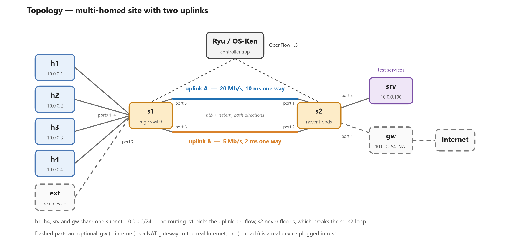
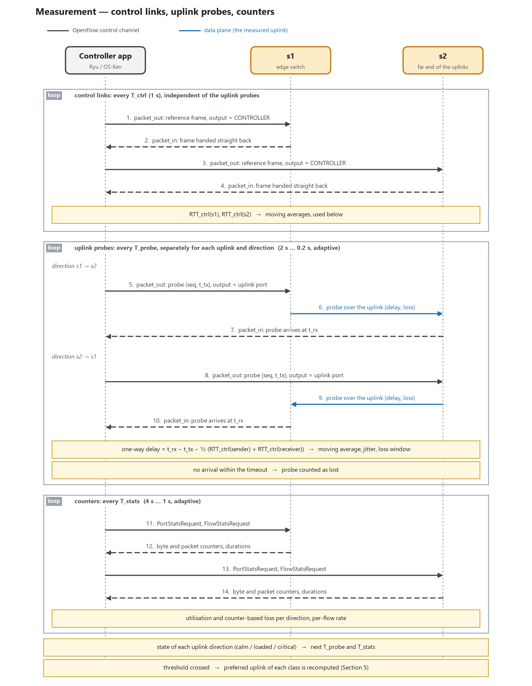

# Reactive Multi-Homing Link Selection Based on Active Uplink Quality Measurements

SDN project for the *Sieci Sterowane Programowo* (Software-Defined Networks) course, AGH University of Krakow, winter semester 2026/27.

Controller: **Ryu / OS-Ken** (Python, OpenFlow 1.3)
Emulation: **Mininet** with Open vSwitch

## 1. Goal

Design and implement a reactive controller application for a multi-homed site: a local network connected to the outside world through two uplinks with different characteristics (bandwidth, latency, loss). The controller continuously measures the quality of both uplinks and dynamically decides which uplink each new flow should use. When an uplink degrades or fails, affected traffic is migrated to the other uplink; when it recovers, traffic is rebalanced.

The project falls under the course topic *dynamic routing depending on link load / packet loss / delay*. It also covers *dynamic traffic measurements*: the measurement frequency changes with the load of the links.

## 2. Assumptions and scope

### In scope

- Two uplinks (A and B) from a single edge switch towards a common "Internet" endpoint, emulated as two separate paths in Mininet with distinct `TCLink` parameters.
- Active quality measurement of each uplink performed by the controller itself (probe packets injected with `packet_out` at one end of an uplink and captured with `packet_in` at the other), yielding delay, jitter and packet loss per uplink and direction.
- Passive load measurement via periodic OpenFlow port and flow statistics requests.
- Measurement intervals that adapt to the state of each uplink: probing and polling speed up when an uplink is loaded or suspect and slow down when it is stable.
- Per-flow classification into two traffic classes:
  - **latency-sensitive** (e.g. VoIP/UDP media, SSH, DNS, ICMP),
  - **bulk** (large TCP transfers and everything else).
- Uplink selection for every new flow based on its class and the current uplink weights.
- Reactive migration of flows on uplink degradation (threshold crossed) or failure (port down / link down event), and rebalancing on recovery.
- Hysteresis in the decision logic to avoid flow flapping between uplinks.
- A read-only live dashboard served by the controller (topology, uplink metrics, flow-to-uplink assignment).

### Out of scope

- NAT or per-uplink public addressing. Both uplinks lead to the same destination network, so flows keep their addresses when migrated and TCP sessions survive the switch. The limitations of migrating stateful sessions across NAT-ed ISP uplinks are discussed in the documentation but not implemented. The optional Internet gateway of Section 3.6 does NAT behind `s2`, after the two uplinks have merged, so it does not change this.
- Multi-switch topology discovery, Dijkstra-style path computation and loop handling. The topology is fixed and known to the application.
- MPLS-based flow aggregation from [9]. It reduces the number of entries in core switches; this network has a single decision point and no core.
- Deep packet inspection. Classification uses L3/L4 header fields only.
- Spanning-tree or any other generic loop-prevention mechanism; the `s1`–`s2` loop is handled by design (Section 3.3).
- Elephant-flow detection — a possible extension if time permits (see Section 8).

### Course requirements this design satisfies

- **Reactive control** — every decision is triggered by a network event: a new flow (`packet_in`), a statistics report, a probe result, or a port/link state change. The measurement rate itself follows the state of the uplinks (Section 4).
- **Integral controller module** — the application is a Ryu/OS-Ken `RyuApp`, not an external script using a REST API. The dashboard only reads the application's internal state.
- **Real-time demonstration** on a running virtual network with traffic generators (Section 7).

## 3. Topology

One topology is used for development and for the final demonstration. It is defined in [`topology/topo.py`](topology/topo.py).



### 3.1 Nodes and addressing

| Node | Role | Address | Attached to |
|------|------|---------|-------------|
| `h1`–`h4` | LAN hosts, traffic sources | `10.0.0.1`–`10.0.0.4/24`, MAC `00:00:00:00:00:01`–`:04` | `s1` ports 1–4 |
| `s1` | edge switch, DPID 1. The uplink of every flow is chosen here. | — | ports 1–4 LAN, port 5 uplink A, port 6 uplink B, port 7 external device (optional) |
| `s2` | switch at the far end of the uplinks, DPID 2. It never floods and sends return traffic over the uplink chosen at `s1`, see Section 3.3. | — | port 1 uplink A, port 2 uplink B, port 3 `srv`, port 4 `gw` (optional) |
| `srv` | test server: the simulated services used for measurements (`iperf3`, HTTP) | `10.0.0.100/24`, MAC `00:00:00:00:01:00` | `s2` port 3 |
| `gw` | optional (`--internet`): NAT gateway to the real Internet and default route of `h1`–`h4`, see Section 3.6 | `10.0.0.254/24`, MAC `00:00:00:00:02:00` | `s2` port 4 |
| external device | optional (`--attach`): a real device or VM plugged into the LAN, see Section 3.6 | a free address in `10.0.0.0/24` | `s1` port 7 |

All hosts, `srv` and `gw` are in one subnet, `10.0.0.0/24`; no routing is involved. Both switches are Open vSwitch bridges speaking OpenFlow 1.3 to a remote controller at `127.0.0.1:6653`, with fail-mode `secure`: they forward nothing until the controller installs rules.

### 3.2 Uplinks

| Uplink | `s1` port | `s2` port | Bandwidth | Delay (one way) | RTT | Loss | Queue |
|--------|-----------|-----------|-----------|-----------------|-----|------|-------|
| A — high bandwidth, higher latency | 5 (`s1-eth5`) | 1 (`s2-eth1`) | 20 Mb/s | 10 ms | ≈ 20 ms | 0 % | 100 packets |
| B — low bandwidth, low latency | 6 (`s1-eth6`) | 2 (`s2-eth2`) | 5 Mb/s | 2 ms | ≈ 4 ms | 0 % | 100 packets |

- Both uplinks are plain L2 paths to the same destination network. There is no NAT and no separate ISP router per uplink, so a flow keeps its addresses when it is migrated between uplinks.
- Bandwidth is enforced with `htb`, delay and loss with `netem` (Mininet `TCLink`), in both directions. Access links (`h*`–`s1`, `s2`–`srv`) are not shaped, so the uplinks are the only bottleneck.
- The values are a starting point and will be tuned so that a single bulk flow saturates uplink B but not uplink A.
- Measured on the running topology (several runs under WSL2): RTT `h1`→`srv` 20–22 ms over A and 4.1–4.6 ms over B; TCP throughput 18.9 Mb/s over A and 4.4–4.8 Mb/s over B. Emulated delays read a few percent off under WSL2, which is why the bring-up check accepts a tolerance.

### 3.3 Loop handling

Two parallel links between `s1` and `s2` form an L2 loop. To avoid broadcast storms:

- `s2` never floods. Its default rules, installed by the controller at connection time, deliver frames arriving from an uplink to `srv` (or `gw`) by destination MAC, and send frames from `srv` or `gw` towards the LAN over the uplink currently designated as *primary* (updated on failover). Nothing is ever passed from one uplink to the other.
- `s1` sends broadcast frames (ARP) towards the far side on the primary uplink only; towards the LAN side it floods normally. A broadcast arriving from an uplink is never sent back to an uplink.
- No spanning-tree protocol is used; this is a deliberate design assumption of the project.

**Return traffic.** The uplink of a flow is chosen at `s1`, but the packets coming back are put on an uplink by `s2`. For every flow the controller therefore installs a matching rule on `s2` that sends the return direction over the same uplink, and changes both rules together when the flow is migrated. Without it, return traffic — most of the volume of a download or a video call — would always take the primary uplink, whatever was decided at `s1`. On a real multi-homed site the return path follows the address the flow left with; `s2` reproduces that in this single-subnet emulation.

For the same reason a generic learning switch (for example Ryu's `simple_switch_13`) must not be attached to this topology: it floods ARP on both uplinks and the network melts within seconds.

### 3.4 Running the topology

Requirements are listed in Section 11. All commands are run from the repository root.

```
sudo python3 topology/topo.py --test      # automated bring-up check, exit code 0 on success
sudo python3 topology/topo.py --static    # Mininet CLI, static rules, no controller needed
sudo python3 topology/topo.py             # Mininet CLI, switches connect to the controller
```

`--test` and `--static` install static OpenFlow rules with `ovs-ofctl` that pin all traffic to one uplink (the rules of Section 3.3 plus destination-MAC forwarding on `s1`). They exist only to show that the topology comes up and the links have the declared parameters, before the controller application is written. They do not react to anything; uplink selection remains the job of the controller.

`--test` checks, for each uplink in turn: `pingall` between all hosts and `srv`, the RTT against the configured delay, and the TCP throughput against the configured bandwidth. It then degrades and restores uplink B at runtime and takes uplink B down and up again:

```
*** Bring-up check (static rules, no controller)
  [ OK ] uplink A: pingall between h1, h2, h3, h4, srv, 0% loss
  [ OK ] uplink A: h1 -> srv RTT 20.2 ms, loss 0% (expected about 20 ms)
  [ OK ] uplink A: h1 -> srv TCP throughput 18.9 Mb/s (configured 20 Mb/s)
  [ OK ] uplink B: pingall between h1, h2, h3, h4, srv, 0% loss
  [ OK ] uplink B: h1 -> srv RTT 4.1 ms, loss 0% (expected about 4 ms)
  [ OK ] uplink B: h1 -> srv TCP throughput 4.4 Mb/s (configured 5 Mb/s)
  [ OK ] uplink B degraded to 50 ms: h1 -> srv RTT 100.2 ms, loss 0% (expected about 100 ms)
  [ OK ] uplink B restored: h1 -> srv RTT 4.2 ms, loss 0% (expected about 4 ms)
  [ OK ] uplink B down: traffic pinned to B is lost (100% loss)
  [ OK ] uplink B down: traffic moved to A gets through (0% loss)
  [ OK ] uplink B recovered
*** RESULT: PASS (11/11 checks passed)
```

Without `--static` and without a running controller the hosts cannot reach each other. That is expected (fail-mode `secure`), not a fault of the topology.

If a previous run was interrupted, clean up with `sudo mn -c`.

### 3.5 Changing uplink quality at runtime

The Mininet CLI started by `topo.py` has extra commands that emulate degradation and failure of an uplink. They work in every mode, also while the controller is running:

| Command | Effect |
|---------|--------|
| `uplinks` | show current parameters and state of both uplinks |
| `degrade A\|B [delay=80ms] [loss=3] [bw=2] [jitter=5ms] [queue=100]` | change the quality of an uplink in both directions (loss in %, bandwidth in Mb/s) |
| `restore A\|B\|all` | back to the default parameters |
| `fail A\|B` | bring the uplink down on both ends; the switches report port down to the controller |
| `recover A\|B` | bring the uplink back up |
| `uplink A\|B` | `--static` only: pin all traffic to the given uplink |

### 3.6 Optional: real Internet and an external device

By default the topology is closed: `srv` is the only destination and all traffic is generated. Two options, which can be combined with every mode of Section 3.4, open it to real traffic.

```
sudo python3 topology/topo.py --internet                  # add the gw node
sudo python3 topology/topo.py --internet --attach eth1    # and plug interface eth1 into s1
sudo python3 topology/topo.py --internet --test           # bring-up check including the Internet path
```

**`--internet`** adds `gw` on port 4 of `s2`. It is a NAT gateway (Mininet's `NAT` node: iptables masquerading through the machine Mininet runs on). `h1`–`h4` get `10.0.0.254` as their default route and a DNS server (`--dns`, default `1.1.1.1`), so a LAN host reaches the real Internet over whichever uplink its traffic is put on. The NAT sits behind `s2`, after the two uplinks have merged, so a flow still keeps its addresses when it changes uplink. With `--test` the check also covers this path:

```
  [ OK ] Internet over uplink A: h1 -> 1.1.1.1 RTT 43.3 ms, loss 0%
  [ OK ] Internet over uplink B: h1 -> 1.1.1.1 RTT 25.3 ms, loss 0%
  [ OK ] Internet traffic follows the pinned uplink: RTT over A minus RTT over B = 18.0 ms (expected about 16 ms)
  [ OK ] DNS from h1 through 1.1.1.1: example.com -> 104.20.23.154
  [ OK ] HTTPS from h1: https://example.com -> HTTP 200
*** RESULT: PASS (16/16 checks passed)
```

A real application can then be put on the emulated uplinks in two ways:

- **inside a LAN host** — a program started in `h1` from the Mininet CLI, for example a browser on a machine with a desktop, sends its traffic through `s1`;
- **from a real device** — `--attach IFACE` makes an existing interface of the machine port 7 of `s1`. A laptop, phone or VM connected to that interface becomes a LAN client. It needs a static configuration: a free address in `10.0.0.0/24`, gateway `10.0.0.254` and a DNS server. No DHCP server is provided.

Things to know:

- `--internet` enables IP forwarding and adds four iptables rules on the machine while the topology runs, and removes them on exit. After a crash they may stay behind; `sudo mn -c` does not remove them.
- It cannot be used where the machine's own network is `10.0.0.0/24`.
- The interface given to `--attach` must not carry an address of the machine, and the machine cannot use it for anything else while it is attached.
- Both options were tested under WSL2, `--attach` with a virtual interface standing in for the device. A GUI application inside a host and a physical interface have not been tested yet.
- The static rules (`--static`, `--test`) cover both options. For the controller, `gw` is a second destination behind `s2` and the external device is one more LAN port.

## 4. Measurement

### What the controller platform provides

Ryu and OS-Ken have no ready-made link latency or loss measurement. The bundled topology module (`topology.switches`) discovers links with LLDP but does not time them: the timestamp it keeps per port only schedules the next LLDP transmission. What the platform does provide are the building blocks: `packet_out` / `packet_in`, OpenFlow `EchoRequest` / `EchoReply`, port and flow statistics, port status events, and green threads for periodic tasks. The measurement described below is therefore implemented in the application itself.



The figure shows the three independent measurement loops. Steps 1–4 measure the control links, steps 5–10 the two directions of an uplink, and steps 11–14 collect counters; only steps 6 and 9 travel through the data plane.

### Control links

The connection between the controller and each switch is measured on its own, independently of the uplink probes, as in [19]. Every `T_ctrl` (default 1 s) the controller sends each switch a reference frame with `packet_out` whose only action is to hand it back, and times the returning `packet_in`. This is the method of [6]; the frame goes through the same `packet_out` and `packet_in` handling as a probe. The results, `RTT_ctrl(s1)` and `RTT_ctrl(s2)`, are kept as moving averages. They are also shown on the dashboard, because a slow control link makes every decision late.

### Active probing

Probes are one-way, as in [6] and [19]: injected at one switch and collected at the other. Each uplink is probed in each direction separately, as in [19], because the two directions carry different traffic and have separate queues, so their delay and loss differ. For the direction `s1` → `s2` the controller sends a probe with `packet_out` on the uplink port of `s1`, and a rule on `s2` passes probes arriving from an uplink to the controller as `packet_in`. The direction `s2` → `s1` is probed the same way from the other end. The probe is a small Ethernet frame with a dedicated EtherType, carrying the uplink identifier, the direction, a sequence number and the send timestamp. Both timestamps are taken by the controller, so no clock synchronisation is needed. The interval `T_probe` is set per uplink and direction and follows its state (see *Adaptive measurement interval* below). For every uplink and direction the controller computes:

- **One-way delay** — receive time minus send time, minus half of the control-link round trip of the sending switch and half of that of the receiving switch: `t_rx − t_tx − ½ (RTT_ctrl(sender) + RTT_ctrl(receiver))`, the formula of [6]. Reported as the last sample and as an exponentially weighted moving average.
- **Jitter** — the smoothed absolute difference between consecutive delay samples.
- **Loss ratio** — the share of probes that did not arrive within a timeout, over a sliding window of the last `N` probes.

The RTT of an uplink, used in Section 5, is the sum of its two one-way delays.

**Accuracy of probing through the control channel.** This is the main risk of the measurement. [6] found that probes sent and collected with `packet_out` / `packet_in` gave 4.91 ms on average, with a 95 % confidence interval of 11.0 ms, on a path with 7 ms of configured delay, because a software switch schedules its control plane irregularly; probes that entered and left through the data plane gave 7.16 ± 0.10 ms. Our uplinks differ by about 16 ms of RTT, so the first task of the algorithm milestone is to measure this error on our own setup against `ping`. Three measures follow:

- the control links are measured continuously and their smoothed round trip is subtracted. Subtracting a moving average, not a single paired sample, keeps the noise of the reference frame out of every delay sample;
- a single sample never drives a decision: the weights use the smoothed delay, and the adaptive interval supplies more samples when readings are noisy;
- if the error still hides the difference between the uplinks, the probes move to the data plane as in [6]: the controller host gets a dedicated port on each switch, the application sends and receives probe frames on them directly, and the switches forward them with static rules. The rest of the design does not change.

### Passive statistics

Every `T_stats` — adaptive as well — the controller issues `OFPPortStatsRequest` and `OFPFlowStatsRequest` and derives:

- utilisation of each uplink in each direction (bytes/s transmitted on the uplink port of `s1` for one direction and of `s2` for the other, relative to the configured link rate),
- loss of each uplink in each direction from counters — packets transmitted on one end against packets received on the other end — as a cross-check of the probe loss,
- per-flow throughput (used for the dashboard and the optional elephant-flow extension).

Rates are computed, as in [6], from the byte counters and durations reported by the switch in consecutive replies. [6] also reports spikes in measured throughput when the polling period is close to the period at which the switch updates its counters; for that reason `T_stats` does not go below 1 s and per-flow rates are smoothed.

### Adaptive measurement interval

The measurement rate is not fixed. Each direction of each uplink is in one of three measurement states, derived from the same utilisation thresholds that drive the weights (Section 5.1) and from the probes themselves:

| State | Entered when | `T_probe` | `T_stats` |
|-------|--------------|-----------|-----------|
| calm | utilisation below `WarnTh` and no anomaly | 2 s | 4 s |
| loaded | utilisation between `WarnTh` and `CongTh` | 1 s | 2 s |
| critical | utilisation above `CongTh`; or an anomaly — a probe lost, a delay sample far from its moving average, or jitter above its limit; or the uplink is down and is being tested for recovery | 0.2 s | 1 s |

**Why the rate follows the load.** Delay on a link comes mostly from its queue, and queueing delay rises sharply as utilisation approaches capacity — the same relation as in the M/M/1 weight of Section 5.1. Jitter rises with it. A single probe on a loaded uplink therefore says little, and a stable delay estimate needs many more samples than on an idle uplink, where consecutive probes return almost the same value. Shortening the interval under load supplies those samples within the same decision time. This is the dynamic probing of [19]. [6] also sends more probes on a busier path, in proportion to its throughput; here the rate follows utilisation relative to capacity, because that is what fills the queue.

**Why the rate is bounded.** The monitoring is active: every probe is extra traffic on the link it measures, and the uplink that needs the most probes is the one with the least room. `T_probe` therefore never goes below 0.2 s. At that rate the probes in one direction of an uplink amount to less than 3 kb/s, under 0.1 % of uplink B.

- A direction moves to a faster state on the first sample that meets the condition, and back to a slower state only after the condition has been absent for a hold time (default 10 s), so the rate does not oscillate.
- The loss window is counted in probes, so in the critical state it fills faster and a silent failure is detected sooner.
- Port statistics of an uplink are polled at the shorter `T_stats` of its two directions, and flow statistics at the shortest of all. All intervals and the hold time are configurable; the values above are starting points.

### Events

- `OFPPortStatus` / port down → immediate failover of all flows on that uplink.
- Probe loss over the window above a hard threshold → uplink declared *down* even if the port is up (silent failure).

## 5. Decision algorithm (work in progress)

> **Status: draft.** This section is a working proposal, not a final design. The algorithm is the subject of the next project meetings; the formula, thresholds and rules below may still change, and none of it is implemented yet.

The algorithm adapts the dynamic link-weight mechanism of Rzym, Duliński and Chołda [9] to a multi-homed edge and extends it with link quality measured as in [6] and [19] and with traffic classes. Section 13 states precisely what is taken from each paper.

### 5.1 Uplink weight

As in [9], the application has a measurement part, which turns counters and probes into link metrics, and a selection part, which turns metrics into weights and weights into forwarding decisions. For uplink `u` with utilisation `ρ_u`, measured RTT `d_u` and loss ratio `l_u`, the weight seen by traffic class `c` is:

```
weight_c(u) = a_c * norm(d_u) + b_c * norm(l_u) + g_c * W(ρ_u)
```

Lower is better; an uplink that is down has infinite weight. The per-direction measurements of Section 4 are combined per uplink: `ρ_u` is the utilisation of the busier direction, `d_u` the sum of the two one-way delays, and `l_u` the loss over both directions. `norm()` scales a metric to `[0, 1]` against a configured maximum. `W(ρ)` is the utilisation weight of [9], selectable in the configuration so that the variants can be compared in the demonstration:

| Variant | `W(ρ)` |
|---------|--------|
| discrete | `NORM` below `WarnTh`, `WARN` between `WarnTh` and `CongTh`, `CONG` above `CongTh` |
| linear | grows linearly with `ρ` |
| M/M/1 (candidate third variant) | grows like the average delay of an M/M/1 queue, `1 / (1 − ρ)` |

`WarnTh` = 50 % and `CongTh` = 80 %, the values used in [9], are the starting point.

The coefficients depend on the traffic class:

| Class             | `a` (RTT) | `b` (loss) | `g` (utilisation) |
|-------------------|-----------|------------|-------------------|
| latency-sensitive | high      | high       | low               |
| bulk              | low       | medium     | high              |

With `a = b = 0` the bulk class reduces to the pure utilisation-driven weight of [9].

### 5.2 Decisions

1. **New flow.** On `packet_in` the flow is classified by L3/L4 fields and 5-tuple rules with an `idle_timeout` are installed for both directions: on `s1` the forward direction points at the *preferred uplink* of its class, and on `s2` the return direction points at the same uplink (Section 3.3).
2. **Recalculation on threshold crossing.** Metrics are updated with every measurement, but the preferred uplink of each class is recomputed only when a threshold is crossed in either direction — utilisation `WarnTh` / `CongTh`, the RTT or loss limit of a class, or an uplink state change. This is the trigger rule of [9] and keeps the number of recalculations low. A change takes effect only if the weight difference exceeds a margin `H` for `K` consecutive evaluations (hysteresis).
3. **Flow stability.** A recalculation changes the uplink for new flows only. Existing flows stay where they are until they end, as in [9], so a recalculation never disturbs running sessions.
4. **Failure or hard degradation.** When an uplink is declared down (port down, or probe loss above the hard threshold), all its flows are moved to the other uplink at once by modifying their output port on both switches (`OFPFC_MODIFY`), latency-sensitive flows first. A latency-sensitive flow is also moved when its uplink violates the hard RTT or loss limit of the class and the other uplink does not.
5. **Recovery.** A failed uplink becomes eligible again after `M` consecutive good probe intervals. New flows may use it immediately; existing flows are rebalanced gradually, bulk flows first, only while their current uplink is above `CongTh` and the recovered one is below `WarnTh`.

Points 4 and 5 are the only cases in which an existing flow is moved, and they go beyond [9]: that mechanism handles congestion in a network with many alternative paths, whereas a multi-homed site must also survive the loss of one of its two uplinks.

All thresholds and coefficients are configurable from a single YAML/JSON file.

## 6. Dashboard

A lightweight web page served by a small HTTP server that the application starts inside the controller process, refreshed every second from a JSON endpoint exposing the application's in-memory state. Ryu's `WSGIApplication` helper is not relied on: the OS-Ken releases we checked (2.11.2, 3.1.1, 5.0.0) no longer ship it. It shows:

- both uplinks with current delay, jitter, loss and utilisation in each direction, and status (healthy / degraded / down),
- the round trip of the control link to each switch,
- the measurement state and current probing interval of each uplink,
- time-series charts of RTT and utilisation per uplink,
- the list of active flows with class, assigned uplink and throughput,
- a log of recent decisions (assignments, migrations, failovers).

The dashboard is read-only and contains no control logic.

## 7. Demonstration scenario

Traffic generators: `iperf`/`iperf3` (TCP bulk, UDP constant-bitrate "VoIP"), `ping`, `curl` against an HTTP server on `srv`, `hping3` if needed.

1. **Steady state.** Start a UDP constant-bitrate stream (latency-sensitive) and a bulk TCP transfer. Show that the UDP stream is placed on the low-latency uplink B and the TCP transfer on the high-bandwidth uplink A, and that the loaded uplink is measured more often than the quiet one.
2. **Degradation.** Inject delay and loss on uplink B (`degrade B delay=80ms loss=3`). The probing interval of B drops to 0.2 s as soon as the first probe arrives late or is lost. Within a few seconds the UDP stream migrates to A; the bulk transfer stays on A because bandwidth is still available. Show the jitter/loss report of the UDP stream before and after.
3. **Failure.** Bring uplink A down (`fail A`). All flows fail over to B; the bulk transfer slows down but continues. Bring A back up (`recover A`) and show the flows being rebalanced.
4. **Control run.** Repeat scenario 2 with the decision logic disabled (static assignment) to show the difference.

Each step is visible both in terminals and on the dashboard.

## 8. Possible extensions

- Elephant-flow detection from flow statistics and pinning of elephants to the high-bandwidth uplink regardless of class [18].
- Real application traffic: with the Internet gateway of Section 3.6, a real application, for example a video call, runs over the emulated uplinks instead of generated traffic.
- A third uplink to show that the weights generalise beyond two links.
- Per-class bandwidth guarantees using OpenFlow meters.

## 9. Milestones

Aligned with the course schedule:

| Milestone                                 | Deliverable                                          |
|-------------------------------------------|------------------------------------------------------|
| Topic and literature, Git repository      | this README, literature list with the role of each paper (Sections 13–14) |
| Topology                                  | Mininet script with runtime link manipulation and a bring-up check (`topology/topo.py`) |
| Applications / traffic generators         | generator scripts, demonstration script              |
| Algorithm                                 | controller application, configuration, dashboard     |
| Presentation (21.01.2027)                 | live demo, technical documentation, slides           |

## 10. Repository layout

```
.
├── controller/        # Ryu/OS-Ken application (main app, probing, stats, decision, dashboard) — planned
├── topology/          # topo.py: Mininet topology, static bring-up rules, bring-up check; draw_topology.py: regenerates the figure
├── traffic/           # traffic generator scripts — planned
├── dashboard/         # static HTML/JS for the live view — planned
├── config/            # thresholds, weights, link parameters — planned
├── docs/              # figures (topology, measurement sequence) and draw_measurement.py, technical documentation, measurements, screenshots
└── README.md
```

## 11. Environment

- Ubuntu 22.04 (VM, container or WSL2)
- Mininet 2.3.x, Open vSwitch 2.17+ (`sudo apt install mininet openvswitch-switch`)
- Python 3.10 and OS-Ken 3.1.x in a virtual environment: `pip install "os-ken<4"`. OS-Ken 5.0.0, the newest release, no longer ships the `osken-manager` launcher; 3.1.1 does. Alternative: Ryu 4.34 on Python 3.8/3.9.
- `iperf3`, `iproute2` (`tc`), `hping3`
- for `--internet`: `iptables` and Internet access on the machine

Verified on Ubuntu 22.04.5 under WSL2 (kernel 6.6) with Mininet 2.3.0, Open vSwitch 2.17.12 and iperf3 3.9: the bring-up check passes, and both switches connect to `osken-manager` from OS-Ken 3.1.1.

## 12. Team

- Maciej Dyrdał
- Mateusz Purol
- Maciej Skała
- Szymon Wątroba

## 13. Literature — what we take from each paper

Numbers refer to the reference list in Section 14.

### Main sources: the mechanism we implement

**[9] Rzym, Duliński, Chołda (2024) — decision algorithm.**
The paper proposes a controller mechanism built from a Measurement Component, which periodically reads interface counters of the switches and computes link utilisation, and a Label Allocator Component, which keeps link weights in a virtual link-state database and recomputes paths. Link weights are a function of utilisation; four variants are compared — discrete (a constant weight per utilisation range), linear, M/M/1 and M/G/1 (the weight follows the average delay of a queueing model). Weights are updated with every reading, but paths are recomputed only when the utilisation of a link crosses a threshold (`WarnTh` = 50 %, `CongTh` = 80 %) in either direction. New flows follow the newly computed paths while existing flows stay on their paths until they end, which keeps the network stable.

*We take:* (1) the split into measurement and selection; (2) the uplink weight as a function of measured utilisation, with the discrete and linear variants implemented and selectable so that they can be compared, as the paper does; (3) recalculation triggered by threshold crossing instead of by every sample, with the same starting thresholds; (4) flow stability — a recalculation affects new flows only.

*We differ:* our network has one edge switch and two parallel uplinks, so path computation reduces to choosing an uplink, and the MPLS-based aggregation with two flow tables, which reduces state in core switches, is not needed. The paper does not consider QoS constraints and names them as a possible direction; we add measured delay and loss to the weight and make the coefficients depend on the traffic class, as our own extension of the mechanism. We also move existing flows when their uplink fails or violates a hard limit — a case outside the scope of the paper, which targets congestion.

**[6] van Adrichem, Doerr, Kuipers (2014), OpenNetMon — monitoring inside the controller.**
OpenNetMon is a module for the POX controller that monitors throughput, packet loss and delay per flow. Throughput is computed from flow statistics polled at the last switch of each path, at an adaptive rate: faster when new flows arrive or flow statistics change, slower when they are stable. Packet loss is the difference between the packet counters of the first and the last switch of a path. Delay is measured with probe packets injected at the first switch and returned to the controller by the last one; the controller-to-switch delay, measured with packets that a switch returns immediately, is subtracted. Probes are small frames (72 bytes) sent at a rate proportional to the traffic on the path. In the evaluation, probes carried over the OpenFlow control channel gave inaccurate delays (4.91 ms on average with a 95 % confidence interval of 11.0 ms on a 7 ms path), while probes carried over the data plane through a separate VLAN were accurate (7.16 ± 0.10 ms).

*We take:* the delay measurement as it stands — a probe injected at one switch and handed to the controller by the other, with half of each control-link round trip, measured by immediately returned packets, subtracted; loss from the counters at the two ends, applied to port counters because we need loss per uplink rather than per flow, as a passive cross-check of probe loss; the adaptive polling rate; a probe rate that grows with traffic; and the warning about the control channel, which sets the validation step and the data-plane fallback of Section 4.

*We differ:*

- we monitor two fixed uplinks instead of every flow path, so the cost depends on the number of links, not on the number of flows;
- [6] scales its probe rate with the throughput on a path; here, as in [19], the rate follows utilisation relative to capacity, because that is what fills the queue — 4 Mb/s is critical for uplink B and calm for uplink A;
- besides load, the rate reacts to the probes themselves — a lost probe, a delay jump, high jitter — so it also rises when quality degrades at constant throughput;
- the rate goes up on the first suspicious sample, comes down only after a hold time, and is capped by a probe budget.

### Earlier work by a member of the team

**[19] Skała, Medagliani, Steiakogiannakis (2016), STOC — statistics application with dynamic probing.**
Earlier work co-authored by a member of this team, presented at ONOS Build 2016 in Paris. STOC is an abstraction layer for the ONOS controller. Its statistics application collects delay, jitter and traffic statistics of the network and serves them to a forwarding application and to a GUI alert system. Links are probed in each direction separately, and the connections between the controller and the switches are measured on their own, independently of the link probes. The system as presented used dynamic probing: the probing interval of a link is adjusted to its load. The reasoning is that queueing delay rises sharply as a link, or the switch behind it, approaches its capacity, and jitter rises with it, so a loaded link needs many more probes than an idle one for a stable reading. Because the monitoring is active, the probe rate is bounded at the same time, so that the probes do not add to the congestion they are measuring.

*We take:* the architecture — a statistics module inside the controller that maintains link status for the forwarding logic and for the live view; the measurement layout — per-direction link probes and independently measured control links; and dynamic probing with this reasoning: more samples where the reading is noisy, within a fixed probe budget (Section 4). Both are re-implemented for Ryu/OS-Ken.

### Supporting sources

- **[10] Isyaku et al. (2021).** A path selection scheme implemented in Ryu and evaluated in Mininet. It measures links with controller-injected probes, as [6] does. What it adds is a link delivery ratio — the share of probes that come back — next to link latency, and the use of both as one link-quality metric when the path for a new flow is chosen. We take the probe-based loss ratio and the idea of selecting by latency and loss together at flow arrival. The second half of the paper, detection of critical switches, is not used.
- **[8] Phemius, Bouet (2013).** Shows that a controller can measure link latency with small dedicated probe frames (24 bytes, 81 % smaller than a ping packet) at 99.25 % accuracy relative to ping. We use a dedicated minimal probe frame instead of ICMP for the same reason, and validate our RTT against `ping` in the same way.
- **[7] Chowdhury et al. (2014), PayLess.** Analyses the trade-off between monitoring accuracy, timeliness and overhead of statistics polling and proposes an adaptive polling algorithm. It is the basis for keeping `T_stats` in seconds rather than milliseconds and, together with [6], for the adaptive measurement interval of Section 4.
- **[16] Sharma et al. (2013).** Compares controller-driven restoration with pre-installed protection in OpenFlow networks; restoration time grows with the number of flows to be re-installed. This is why failover moves latency-sensitive flows first, why the failover time is measured and reported in the documentation, and why fast-failover groups are a known improvement.
- **[17] RFC 2439.** Route flap damping: an unstable route is suppressed until it has been stable for some time. The same idea is behind the hysteresis margin and the `M` consecutive good probe intervals required before a recovered uplink is used again.
- **[14] RFC 4116.** Describes IPv4 multihoming practices and their limitations; it is the argument for keeping both uplinks in one address space without NAT, so that sessions survive a change of uplink.

### Background

- **[1]–[5]** — OpenFlow, the SDN architecture, the OpenFlow 1.3 specification, Mininet and the controller documentation: the tools the project is built with.
- **[11]** — survey of traffic engineering in OpenFlow networks; places the project among flow management and fault tolerance techniques.
- **[12], [13], [15]** — SD-WAN architectures and Google B4; the commercial and large-scale context of choosing among several WAN links from a central controller.
- **[18]** — Hedera; source of the elephant-flow extension in Section 8.

## 14. References

### SDN foundations and tooling

1. N. McKeown, T. Anderson, H. Balakrishnan, G. Parulkar, L. Peterson, J. Rexford, S. Shenker, J. Turner, "OpenFlow: Enabling Innovation in Campus Networks," *ACM SIGCOMM Computer Communication Review*, vol. 38, no. 2, pp. 69–74, 2008. DOI: 10.1145/1355734.1355746
2. D. Kreutz, F. M. V. Ramos, P. Verissimo, C. E. Rothenberg, S. Azodolmolky, S. Uhlig, "Software-Defined Networking: A Comprehensive Survey," *Proceedings of the IEEE*, vol. 103, no. 1, pp. 14–76, 2015. DOI: 10.1109/JPROC.2014.2371999
3. Open Networking Foundation, *OpenFlow Switch Specification, Version 1.3.5 (Protocol version 0x04)*, ONF TS-023, March 2015. https://opennetworking.org/wp-content/uploads/2014/10/openflow-switch-v1.3.5.pdf
4. B. Lantz, B. Heller, N. McKeown, "A Network in a Laptop: Rapid Prototyping for Software-Defined Networks," *Proc. 9th ACM SIGCOMM Workshop on Hot Topics in Networks (HotNets-IX)*, Monterey, CA, 2010. DOI: 10.1145/1868447.1868466
5. Ryu SDN Framework Community, *Ryu SDN Framework* (ryu-book) and Ryu API documentation; OpenStack, *OS-Ken* documentation. (technical references, no DOI)

### Measurement and monitoring in OpenFlow networks (Section 4)

6. N. L. M. van Adrichem, C. Doerr, F. A. Kuipers, "OpenNetMon: Network Monitoring in OpenFlow Software-Defined Networks," *Proc. IEEE/IFIP Network Operations and Management Symposium (NOMS)*, Kraków, 2014, pp. 1–8. DOI: 10.1109/NOMS.2014.6838228
7. S. R. Chowdhury, M. F. Bari, R. Ahmed, R. Boutaba, "PayLess: A Low Cost Network Monitoring Framework for Software Defined Networks," *Proc. IEEE/IFIP NOMS*, Kraków, 2014, pp. 1–9. DOI: 10.1109/NOMS.2014.6838227
8. K. Phemius, M. Bouet, "Monitoring Latency with OpenFlow," *Proc. 9th International Conference on Network and Service Management (CNSM)*, Zurich, 2013, pp. 122–125. DOI: 10.1109/CNSM.2013.6727820

### Link selection, traffic engineering and multi-homing (Section 5)

9. G. Rzym, Z. Duliński, P. Chołda, "Dynamic Link Metric Selection for Traffic Aggregation and Multipath Transmission in Software-Defined Networks," *Applied Sciences*, vol. 14, no. 12, art. 5312, 2024. DOI: 10.3390/app14125312
10. B. Isyaku, K. A. Bakar, M. S. Mohd Zahid, E. Alkhammash, F. Saeed, F. A. Ghaleb, "Route Path Selection Optimization Scheme Based Link Quality Estimation and Critical Switch Awareness for Software Defined Networks," *Applied Sciences*, vol. 11, no. 19, art. 9100, 2021. DOI: 10.3390/app11199100
11. I. F. Akyildiz, A. Lee, P. Wang, M. Luo, W. Chou, "A Roadmap for Traffic Engineering in SDN-OpenFlow Networks," *Computer Networks*, vol. 71, pp. 1–30, 2014. DOI: 10.1016/j.comnet.2014.06.002
12. Z. Yang, Y. Cui, B. Li, Y. Liu, Y. Xu, "Software-Defined Wide Area Network (SD-WAN): Architecture, Advances and Opportunities," *Proc. 28th International Conference on Computer Communication and Networks (ICCCN)*, Valencia, 2019, pp. 1–9. DOI: 10.1109/ICCCN.2019.8847124
13. C. Fu, B. Wang, W. Wang, "Software-Defined Wide Area Networks (SD-WANs): A Survey," *Electronics*, vol. 13, no. 15, art. 3011, 2024. DOI: 10.3390/electronics13153011
14. J. Abley, K. Lindqvist, E. Davies, B. Black, V. Gill, "IPv4 Multihoming Practices and Limitations," RFC 4116, IETF, July 2005. https://www.rfc-editor.org/rfc/rfc4116
15. S. Jain et al., "B4: Experience with a Globally-Deployed Software Defined WAN," *Proc. ACM SIGCOMM*, Hong Kong, 2013.

### Resilience and failover (Section 7, step 3)

16. S. Sharma, D. Staessens, D. Colle, M. Pickavet, P. Demeester, "OpenFlow: Meeting Carrier-Grade Recovery Requirements," *Computer Communications*, vol. 36, no. 6, pp. 656–665, 2013.
17. C. Villamizar, R. Chandra, R. Govindan, "BGP Route Flap Damping," RFC 2439, IETF, November 1998. https://www.rfc-editor.org/rfc/rfc2439

### Extension (Section 8)

18. M. Al-Fares, S. Radhakrishnan, B. Raghavan, N. Huang, A. Vahdat, "Hedera: Dynamic Flow Scheduling for Data Center Networks," *Proc. 7th USENIX Symposium on Networked Systems Design and Implementation (NSDI)*, San Jose, CA, 2010.

### Earlier work by the team

19. M. Skała, P. Medagliani, I. Steiakogiannakis, "STateful abstraction layer for the ONOS Controller with Bandwidth Calendaring," poster, ONOS Build 2016, Paris, 2016. [PDF](docs/PosterSTOC.pdf)
